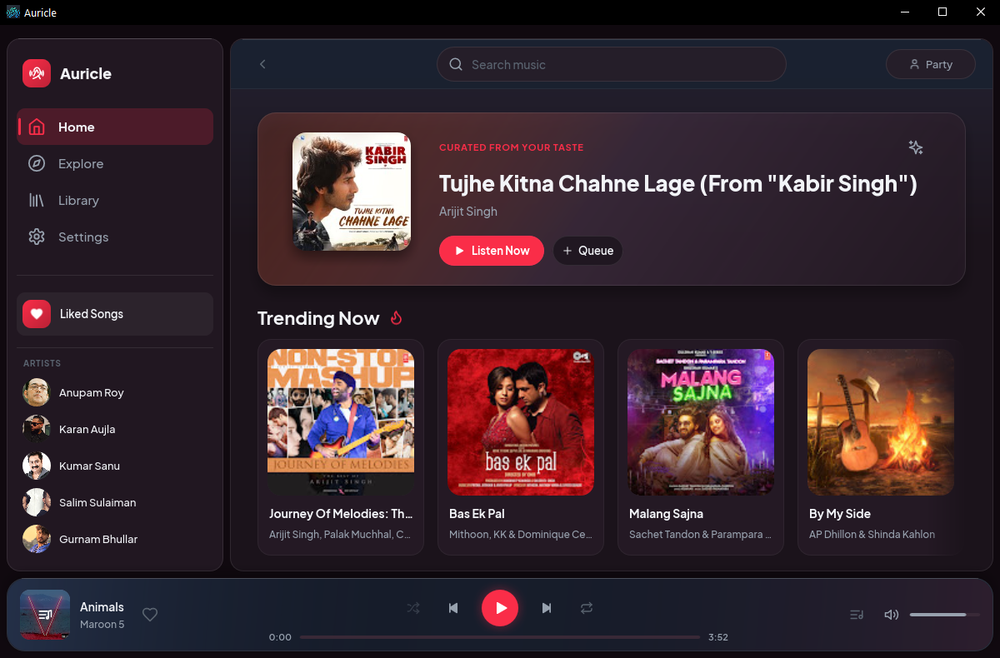
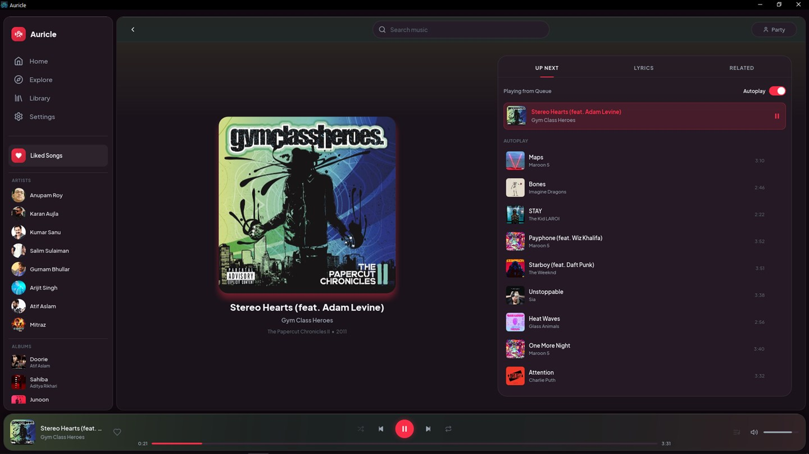
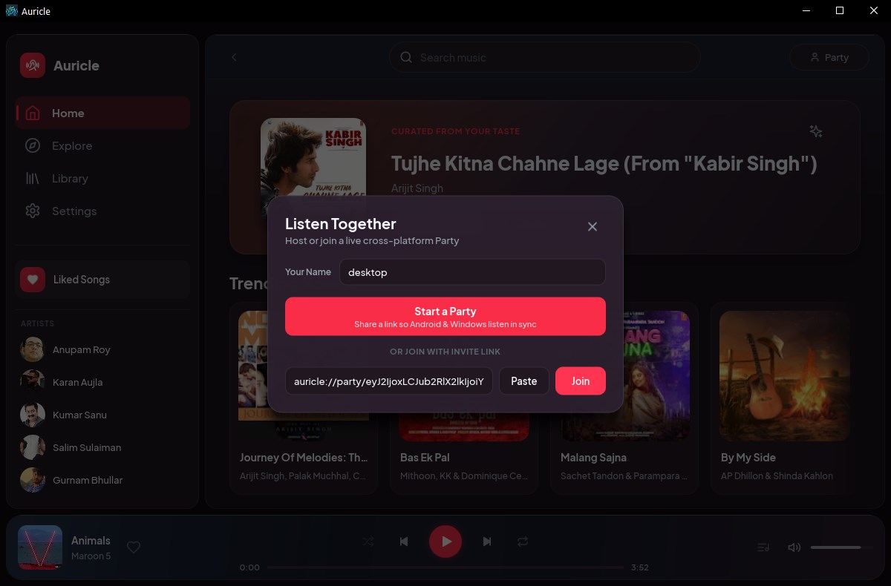

# Auricle

[](https://github.com/californiaAlmonds/auricle/releases/latest)
[](https://github.com/californiaAlmonds/auricle/releases)
[](https://github.com/californiaAlmonds/auricle-android/releases)
[](https://sourceforge.net/projects/auricle/files/)
[](https://community.chocolatey.org/packages/auricle)
[](LICENSE)

Auricle is a fast, native desktop music player for Windows built with **Rust** and the
**[Slint](https://slint.dev/)** UI toolkit, paired with a companion open-source **Android app**
([californiaAlmonds/auricle-android](https://github.com/californiaAlmonds/auricle-android)).
Search the YouTube Music catalogue, organize your local library, view live lyrics, and listen
together across Windows and Android over peer-to-peer QUIC — with no Electron, no accounts,
and no hosted servers.

🌐 **Website:** [californiaalmonds.github.io/auricle](https://californiaalmonds.github.io/auricle/)

[](https://sourceforge.net/projects/auricle/files/latest/download)



| Split Now Playing & Dynamic Themes | Listen Together (Cross-Platform Party) |
| --- | --- |
|  |  |

## Features

- **Listen Together (P2P Party Sync):** Host or join synced listening sessions across Windows and Android via shareable `auricle://party/...` invite links powered by encrypted [Iroh](https://www.iroh.computer/) QUIC connections with relay fallback.
- **Dynamic Material You Themes:** Animated Oklab accent colors derived from the active album artwork, glassmorphic surfaces, and low-CPU idle rendering.
- **Split Now Playing & Sing-Along Lyrics:** Dedicated Now Playing stage with high-res album art, Up Next queue, live Lyrics with an English sing-along toggle, track credits, and Related music.
- **Windows Media Controls (SMTC) & Device Auto-Switch:** Native Windows media overlay, hardware media keys, and automatic output switchover when plugging or unplugging headphones/Bluetooth devices.
- **Catalogue Search & Ranked Discographies:** Search songs, albums, artists, and playlists with search history, mixed previews, and popularity-ranked artist discography rows with All / Albums / Singles & EPs / Compilations filters.
- **Queue, Shuffle, Repeat & Autoplay:** Manage queued tracks with user-queue shuffle, repeat modes (`off` / `all` / `one`), preserved queues, and continuously topped-up Autoplay.
- **Local Library & Audio Cache:** Follow artists, save albums and playlists, keep liked songs and listening history on your device, and reuse recently played audio via a size-limited LRU cache (500 MB default).
- **System Tray & Privacy-First:** Minimize to the Windows tray while playback continues; zero accounts, telemetry, or analytics.

## Companion Android App

Looking for Auricle on mobile? Check out **[californiaAlmonds/auricle-android](https://github.com/californiaAlmonds/auricle-android)** — a native Kotlin + Jetpack Compose + Media3 + Rust Android player with full Listen Together P2P sync compatibility with Auricle for Windows.

- **Android Source & Issues:** [github.com/californiaAlmonds/auricle-android](https://github.com/californiaAlmonds/auricle-android)
- **Android APK Releases:** [github.com/californiaAlmonds/auricle-android/releases/latest](https://github.com/californiaAlmonds/auricle-android/releases/latest) (also mirrored in each [SourceForge](https://sourceforge.net/projects/auricle/files/) version folder)

## Download

- **GitHub Releases (Windows + synced Android APKs):** [Latest Release](https://github.com/californiaAlmonds/auricle/releases/latest)
- **SourceForge Mirror (Windows + Android APKs):** [sourceforge.net/projects/auricle/files](https://sourceforge.net/projects/auricle/files/)
- **WinGet:** `winget install californiaAlmonds.Auricle`
- **Chocolatey:** `choco install auricle`
- **Scoop:** `scoop bucket add auricle https://github.com/californiaAlmonds/scoop-auricle && scoop install auricle`

## Status

Version **0.3.0** brings the modernized Material You shell, split Now Playing with live lyrics and English sing-along toggle, Windows media controls (SMTC) with automatic audio device switching, user-queue shuffle/repeat, ranked artist discographies, and cross-platform Listen Together P2P sync with [Auricle for Android](https://github.com/californiaAlmonds/auricle-android).

Browser cookies are strictly opt-in, yt-dlp always verifies TLS certificates, and Auricle keeps a local diagnostic log with a **Report a problem** option. No Visual C++ Redistributable is required. Streaming depends on external services and optional add-ons, and availability can change. Auricle is not affiliated with YouTube or Google.

## Essential add-ons (yt-dlp, ffmpeg & Deno)

Auricle does **not** bundle or redistribute third-party media tools. Audio
extraction relies on [`yt-dlp`](https://github.com/yt-dlp/yt-dlp), some cache
operations use [`ffmpeg`](https://ffmpeg.org/), and yt-dlp can use
[`Deno`](https://deno.com/) as a JavaScript runtime for YouTube. On first run, Auricle
offers an optional **"Install essential add-ons"** step that can download these tools
from their official GitHub releases into `%LOCALAPPDATA%\auricle\bin`.

Installing them is entirely at your own discretion and choice. You may also install
them yourself and make them available on your `PATH`. Auricle will detect existing
installations and skip them.

Once yt-dlp is installed, Auricle keeps it current automatically: it runs
`yt-dlp -U` in the background at most once a week (falling back to downloading the
latest release), and once per session if playback starts failing because yt-dlp is out
of date.

By default Auricle never uses your browser cookies. If YouTube asks you to sign in to
confirm you're not a bot, you can turn on **Use browser cookies for YouTube** in
Settings > Privacy & diagnostics. After you accept the explanation, yt-dlp may read your
YouTube cookies from Edge, Chrome or Firefox and send them only to YouTube; you can turn
it off again at any time.

These tools are licensed by their respective authors; Auricle is not affiliated with
them and does not distribute them.

## Privacy

Auricle has no accounts, telemetry, analytics or automatic crash reporting, and keeps your
library, history and logs on your PC. See the [privacy policy](https://californiaalmonds.github.io/auricle/privacy.html)
for what is stored locally and what is sent to YouTube, Google, GitHub, and optional P2P Party relays.

## Troubleshooting

Auricle writes a diagnostic log to `%LOCALAPPDATA%\auricle\logs\auricle.log`. If it
can't start, it shows an error with an option to report it. You can also use
**Settings > Privacy & diagnostics > Report a problem**, which opens a prefilled GitHub
issue for you to review and submit, plus the log folder so you can attach the log.
`auricle.exe --version` and `auricle.exe --help` print to the console and exit.

## Prerequisites

- [Rust](https://www.rust-lang.org/tools/install) (edition 2021, Rust ≥ 1.91)
- Windows with the MSVC C++ Build Tools
- (Optional) `yt-dlp`, `ffmpeg`, and `Deno`, installed via the in-app add-on step or manually

## Build & Run

The project is driven by Cargo through convenience npm scripts:

```bash
# Debug build
npm run build

# Run the native shell
npm run run

# Release build
npm run release
```

Equivalent direct Cargo commands:

```bash
cargo run --bin auricle
```

## Architecture

- `ui/native_shell.slint` — Slint UI: layout, dynamic themes, Now Playing, Party modal, and state.
- `src/lib.rs` — `run_native_shell()` wires UI callbacks to backend logic.
- `src/core/bridge.rs` — shared `PlaybackCore` singleton.
- `src/core/playback.rs` — queue, shuffle/repeat, history, likes, audio device follow, and playback worker.
- `src/core/party.rs` — cross-platform Iroh QUIC P2P Listen Together sync engine.
- `src/core/media_controls.rs` — Windows SMTC media flyout and media key integration.
- `src/core/stream_player.rs` — HTTP/range streaming audio source.
- `src/core/cache.rs` — LRU on-disk audio cache.
- `src/core/search.rs` — search client with result caching and catalogue enrichment.
- `src/now_playing_ui.rs` — split Now Playing lyrics, English sing-along, and related tracks.
- `src/discography_ui.rs` — popularity-ranked artist discography shelves and filters.
- `src/search_ui.rs` — debounced, cancellable search worker wired to the UI.
- `src/context_ui.rs` — unified song/album/artist right-click context menus.

## Technologies

- **UI**: Slint
- **Language / runtime**: Rust, Tokio
- **Audio**: rodio + symphonia (decode/playback), souvlaki (Windows SMTC)
- **P2P Sync**: Iroh (QUIC + relay fallback)
- **Music API**: `ytmapi-rs`
- **Local storage**: JSON metadata and an on-disk LRU audio cache

## Contributing

Contributions follow a `feature → release/x.y.z → main` branch model with
CI-enforced versioning and protected branches. Before opening a pull request,
read [CONTRIBUTING.md](CONTRIBUTING.md) for the branch model, release process,
and rules.

## License

Auricle is free software, licensed under the **GNU General Public License v3.0**.
See [LICENSE](LICENSE) for the full text.

Auricle uses the Slint UI toolkit under its GPLv3 licensing option. Third-party
tools such as `yt-dlp`, `ffmpeg`, and `Deno` are not distributed with Auricle and remain
under their own respective licenses.
